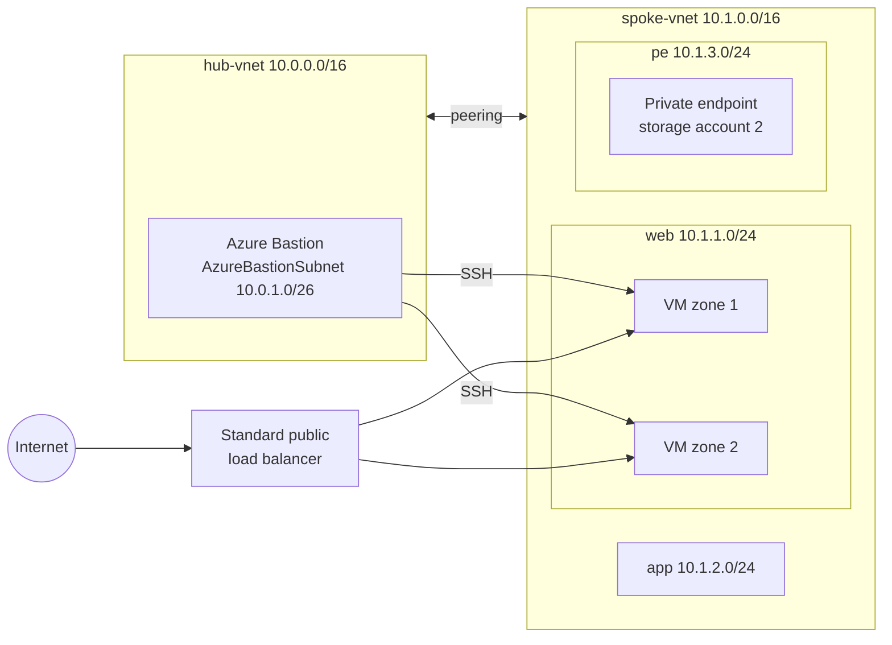

# azure-admin-labs

Hands-on Azure administration labs built while preparing for the **AZ-104: Microsoft Azure Administrator** exam (booked for 15 Dec 2026).

Seven projects cover all five exam domains: a hub-and-spoke landing zone, governance, identity, storage, compute, containers, monitoring and disaster recovery. Everything is deployed with **Azure CLI** or **Bicep**, proven with a hands-on test, and deleted at the end of each session.

## How each project works

1. Create a budget alert before the first resource.
2. Build it in code (`scripts/deploy.sh` or `bicep/`).
3. **Prove it.** For example, sign in as the test user, try the blocked access, or run the restore. A project is done only when the proof passes, and screenshots go in `evidence/`.
4. Write up what broke and the exam notes.
5. Delete everything (`scripts/destroy.sh`).

## Project status

| # | Project | Exam domains | Week | Status |
|---|---------|--------------|------|--------|
| 00 | [Mini landing zone](projects/00-mini-landing-zone/) | All five | 1 | ⬜ Not started |
| 01 | [Governance and VM](projects/01-governance-vm/) | Identity & governance, Compute | 1 | ⬜ Not started |
| 04 | [Identity](projects/04-identity/) | Identity & governance | 2 | ⬜ Not started |
| 02 | [Storage and routing](projects/02-storage-routing/) | Storage, Virtual networking | 2 | ⬜ Not started |
| 05 | [App Service](projects/05-app-service/) | Compute | 3 | ⬜ Not started |
| 06 | [Containers and scale sets](projects/06-containers-scale-sets/) | Compute, Virtual networking | 3 | ⬜ Not started |
| 03 | [Monitoring, backup and recovery](projects/03-monitoring-backup-dr/) | Monitor & maintain | 4 | ⬜ Not started |

Status key: ⬜ Not started · 🟨 In progress · ✅ Proof passed

## Skills-to-exam map

Domains and weights from the official AZ-104 skills outline (skills measured as of 17 April 2026).

| Exam domain | Weight | Projects |
|-------------|--------|----------|
| Manage Azure identities and governance | 20–25% | 00, 01, 04 |
| Implement and manage storage | 15–20% | 00, 02 |
| Deploy and manage Azure compute resources | 20–25% | 00, 01, 05, 06 |
| Implement and manage virtual networking | 15–20% | 00, 02, 06 |
| Monitor and maintain Azure resources | 10–15% | 00, 03 |

## Architecture (Project 00 baseline)



## Repository layout

```
azure-admin-labs/
├── README.md
├── docs/
│   ├── conventions.md     # naming, tagging, address plan
│   ├── cost-log.md        # weekly spend
│   └── exam-notes/        # one file per exam domain
└── projects/
    └── NN-project-name/
        ├── README.md      # Goal · Architecture · Build · Proof · What broke · Exam notes · Cost and clean-up
        ├── diagram/
        ├── scripts/       # deploy.sh, destroy.sh
        ├── bicep/
        └── evidence/      # screenshots of each proof
```

## Conventions

- **Naming, tags and address plan:** [docs/conventions.md](docs/conventions.md)
- **Spend:** checked every Sunday and logged in [docs/cost-log.md](docs/cost-log.md)
- **No secrets in Git:** keys, passwords and SAS tokens live in a gitignored `.env` file or are passed as parameters. Subscription IDs, tenant IDs and public IPs are blurred in screenshots.
- **Commit messages** name the project and the change, e.g. `project-00: add hub-spoke peering and NSG`.

## Tools

Azure CLI · Bicep · Azure Portal · Cloud Shell · AzCopy · Mermaid · draw.io

## Licence

[MIT](LICENSE) © 2026 Madushanka
