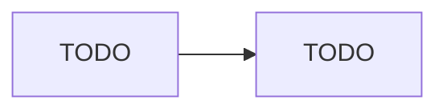

# 06-containers-scale-sets

> Status: ⬜ Not started

## Goal
What this project proves and which exam skills it covers.

## Architecture

Full diagram: [diagram/](diagram/)

## Build
```bash
./scripts/deploy.sh
```

## Proof
- [ ] Proof 1
- [ ] Proof 2

Evidence: [evidence/](evidence/)

## What broke

## Exam notes

## Cost and clean-up
```bash
./scripts/destroy.sh
```
